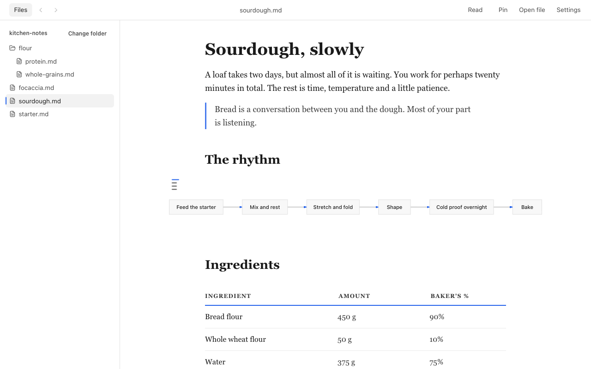
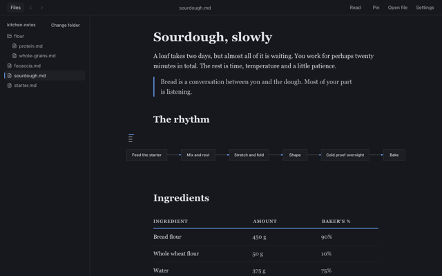
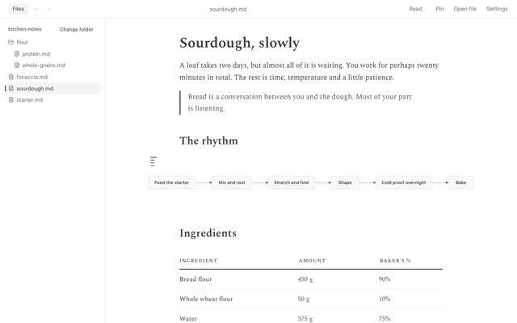
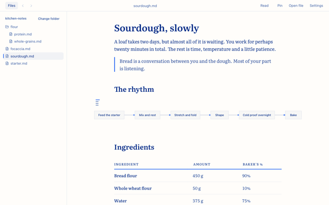
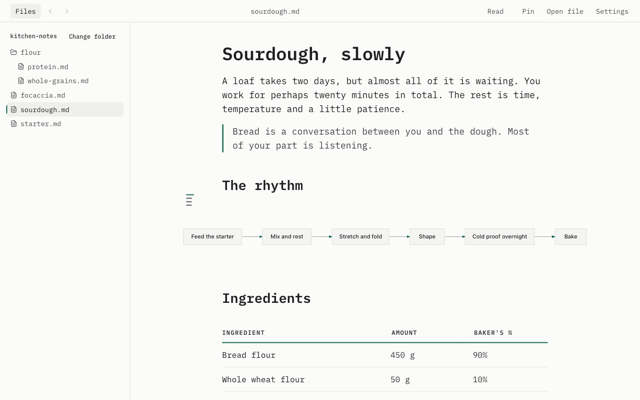
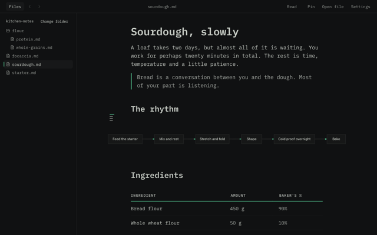
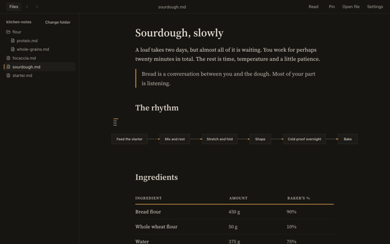

<p align="center"></p>

# Leggio

A markdown reader built for reading. Calm, customizable, offline, private.

**[Open Leggio](https://leggio.compostela.dev)** on a computer or a phone, best in Chrome or Edge on a computer. It works in the browser with no account, and you can install it as an app from there (on an iPhone or iPad: Share, then Add to Home Screen).



*Leggio* is Italian for a reading stand, from *leggere*, to read.

Most markdown apps are editors with a preview on the side. Leggio is only the page, and it tries to be a very good page: a calm layout, type you choose, diagrams drawn in place, and a voice that reads it to you. Notes, documentation and the README of a project you just cloned get the layout and type of a book, not of a source file.

## Features

- **Files and folders.** Open or drop a file, or open a whole folder and browse its markdown files in the Files panel. Relative links and images work, and the page reloads when the file changes on disk.
- **Diagrams.** Mermaid diagrams render inline, in the colors of your theme. A click opens one full size.
- **Read aloud.** Leggio reads the page to you, highlights the sentence it's on, and with local voices the word too. Choose the voice and the speed.
- **Themes and type.** Six looks to start from (Default, Quiet, Cobalt, Teletype, Terminal and Ember), then set the fonts, size, weight, line height, text width and colors yourself. Any Google Font works. The Default look follows your system's light or dark setting.
- **Outline.** A contents rail beside the text marks the section you're reading. Click a heading to jump to it.
- **History.** Back and forward (⌘[ and ⌘]) walk the documents you opened and keep your scroll position. Pin files and folders to keep them across sessions, and Leggio reopens where you left off.
- **Share.** Copy a link that carries the document itself. Nothing is uploaded: the text lives in the link. The person who opens it sees that it was shared, can save it as a file, and web images wait for their click. A long document makes a long link, so for one that is already online (a gist, a file on GitHub: use its Raw address), paste that address into Leggio instead: it opens from there, and Share gives a short link to it.
- **An app of its own.** Install it from the address bar. It gets its own window, works offline, and opens `.md` files from Finder or Explorer.
- **Private.** Your files are read on your device and never uploaded. No accounts, no analytics, no server. Leggio only fetches what you ask it to open. If you pick an online voice for read-aloud, your browser sends the text being read to that voice service, and the voice setting tells you so.

### Themes

<table>
  <tr>
    <td><br><sub>Default, dark</sub></td>
    <td><br><sub>Quiet</sub></td>
  </tr>
  <tr>
    <td><br><sub>Cobalt</sub></td>
    <td><br><sub>Teletype</sub></td>
  </tr>
  <tr>
    <td><br><sub>Terminal</sub></td>
    <td><br><sub>Ember</sub></td>
  </tr>
</table>

Leggio never edits, renames or deletes your files, and it never will. It only reads.

Shortcuts: ⌘O opens a file, ⇧⌘O a folder, ⌘B shows or hides the Files panel. On Windows, use Ctrl.

## Planned

- Search across a folder.

## Requirements

A recent browser, on a computer or a phone. Chrome or Edge on a computer works best: Leggio reads files and folders through the File System Access API, which gives live reload, pins and restoring the last document. In other browsers, on phones and tablets, or when a company setting blocks file access, Leggio reads a copy of the files you open. A copy doesn't update when the file changes, and pins and restore are off. Links, share links and documents opened from a web address work everywhere.

## Develop

You need Node.js 24 or newer and pnpm 10.

```sh
pnpm install
pnpm dev      # http://localhost:8000, rebuilds on change
pnpm test
pnpm build    # writes site/, the folder to deploy
pnpm serve    # build, then serve site/ on http://localhost:8765
```

`site/` is a static site. Upload it to any static host, or see [AGENTS.md](AGENTS.md) for how this one deploys. To contribute, read [CONTRIBUTING.md](CONTRIBUTING.md).

Built with Preact, markdown-it, highlight.js, beautiful-mermaid and esbuild: thirteen packages in total, at exact versions, with install scripts disabled. The icons are paths copied from [Lucide](https://lucide.dev) (ISC), not a dependency.

## License

MIT, see [LICENSE](LICENSE). Bundled third-party licenses are listed in `site/THIRD_PARTY_NOTICES.txt` after a build. The layout engine elkjs is EPL-2.0; its source is at https://github.com/kieler/elkjs.
